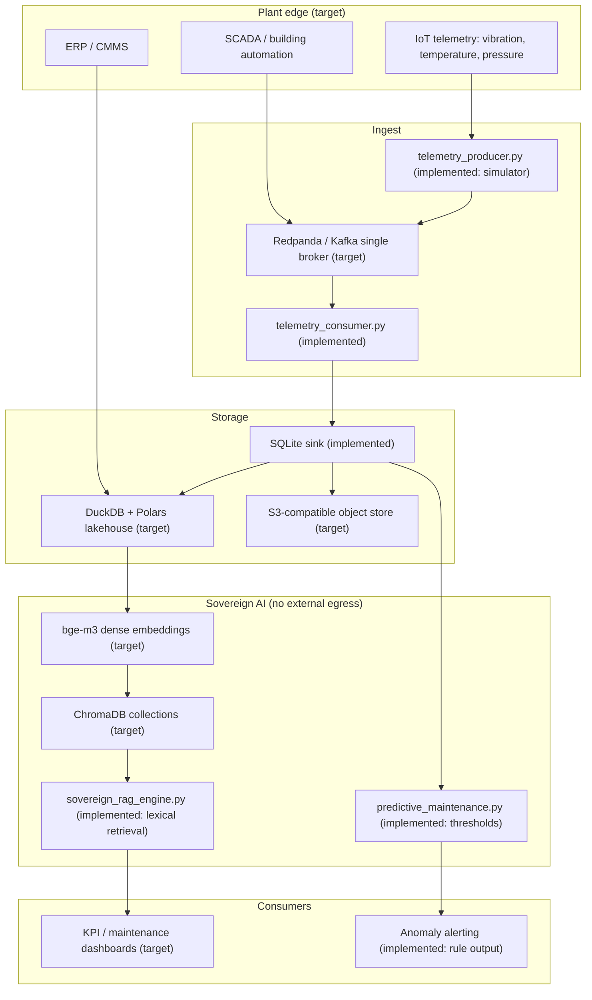

# Enterprise Cloud & Sovereign AI Center of Excellence (CoE)
### A runnable reference implementation: in-kingdom landing zone, industrial telemetry path, and local-only retrieval

[](https://github.com/Amz34/enterprise-cloud-ai-coe/actions)
[](LICENSE)
[](https://www.python.org)

Most "sovereign AI architecture" repositories are slideware. This one is deliberately small: a working
telemetry path, a retrieval path, an anomaly rule set, and a test suite that fails if any of them
breaks. Every capability described below maps to a file in this repository and to an assertion that
CI runs on every push.

**Honest scope:** this repository is a *reference implementation and contract test*, not a deployed
production stack. Section 5 lists exactly what is implemented and what is only a deployment target.

---

## 1. What is in this repository

| Path | What it actually does | Proof |
|---|---|---|
| `streaming/telemetry_producer.py` | Generates synthetic industrial sensor readings (temperature, pressure, vibration) as JSON lines | `tests/test_coe_stack.py::test_telemetry_streaming_and_lakehouse` |
| `streaming/telemetry_consumer.py` | Ingests those records into a schema-checked SQLite sink and returns aggregate statistics | same test — asserts record count and non-zero averages |
| `ai_mlops/sovereign_rag_engine.py` | Deterministic, air-gapped retrieval over a small in-repo document set, scored by cosine-style token overlap. No network calls, no external embedding service | `test_sovereign_rag_retrieval` |
| `ai_mlops/predictive_maintenance.py` | Threshold-based equipment health scoring with per-metric alert reasons | `test_predictive_maintenance_health` |
| `iac/main.tf`, `iac/variables.tf` | Terraform/OpenTofu definitions for an OCI VCN, internet gateway, route table, security list and public application subnet | reviewed in CI; not applied by CI |
| `.github/workflows/ci.yml` | Runs the contract suite on Python 3.11 for every push and pull request | run history |

The three retrieval fixtures (`SAES-L-105`, `SABIC-ENG-STD-402`, `NCA-ECC-1-2018`) are short
illustrative excerpts written for this repository to exercise the matcher. They are not reproduced
standard text and are not a corpus.

---

## 2. Architecture

Solid tiers are implemented in this repository. Dashed tiers are the production deployment target
and are **not** shipped here.



---

## 3. Quickstart

```bash
git clone https://github.com/Amz34/enterprise-cloud-ai-coe.git
cd enterprise-cloud-ai-coe

# Telemetry path: produce, then ingest and aggregate
python3 streaming/telemetry_producer.py
python3 streaming/telemetry_consumer.py

# Retrieval and anomaly scoring
python3 ai_mlops/sovereign_rag_engine.py
python3 ai_mlops/predictive_maintenance.py

# Contract suite (this is what CI runs)
python3 tests/test_coe_stack.py
```

Optional broker, if you want the real thing instead of the simulator:

```bash
cd streaming && docker compose up -d   # single-broker Redpanda, memory-capped
```

---

## 4. What CI proves

CI does not "verify the architecture" in the abstract. It asserts four concrete behaviours:

1. Five simulated readings are ingested and the sink reports exactly five records with non-zero averages.
2. A query for `piping material specifications` returns a match whose document id contains `ARAMCO-SAES-L-105`.
3. A reading inside every threshold returns `status: NORMAL` with `health_score: 100.0`.
4. A reading outside all three thresholds returns `status: ANOMALY_DETECTED`, three alert reasons, and a score below 50.

If any of these stops holding, the build goes red. Anything the suite does not assert is a claim you
should treat as unverified.

---

## 5. Implemented vs deployment target

**Implemented and tested here**

- Sensor record generation and JSON serialisation
- Schema-checked ingestion with aggregate statistics
- Deterministic lexical retrieval with `top_k` and score ranking
- Threshold-based anomaly detection with explainable alert strings
- OCI network definitions: VCN, internet gateway, route table, security list, public subnet

**Deployment target — described, not implemented**

- Streaming through Redpanda/Kafka (the compose file is provided; the Python path bypasses the broker)
- Columnar lakehouse on DuckDB/Polars/PyArrow (the sink is SQLite)
- Dense multilingual embeddings via `bge-m3` and ChromaDB collections (retrieval is lexical)
- Local LLM inference via Ollama/vLLM
- Private subnets, NAT gateway, multi-fault-domain compute, cross-region object replication (the
  Terraform here defines one public subnet and no NAT)

---

## 6. Limitations

- Retrieval is token overlap, not embeddings. It is deterministic and dependency-free, which makes it
  testable; it is not a semantic search engine.
- The anomaly thresholds (85 °C, 15 bar, 0.048 mm/s) are constants in one file. They are illustrative
  operating envelopes, not values derived from any operator's equipment data.
- The sink is in-memory SQLite. Persistence and concurrency behaviour under load are out of scope.
- The Terraform defines a single-region network skeleton. It has not been applied against a live
  tenancy by CI and carries no state backend configuration.
- No authentication, authorisation or audit layer is included.

---

## 7. Contact

**Engr. Aamir Malik Zameer**
Jeddah / Dhahran, Kingdom of Saudi Arabia

- LinkedIn: [linkedin.com/in/aamirzameer](https://linkedin.com/in/aamirzameer)
- GitHub: [github.com/Amz34](https://github.com/Amz34)
- Portfolio: [amz34.github.io](https://amz34.github.io)

---

Part of [my always-on agent stack](https://github.com/Amz34) · [Awesome Agent Infrastructure](https://github.com/Amz34/awesome-agent-infrastructure) (135 live-checked building blocks).
